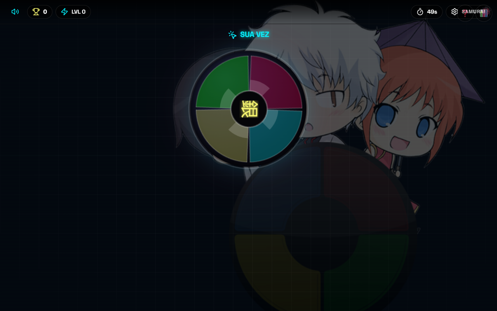
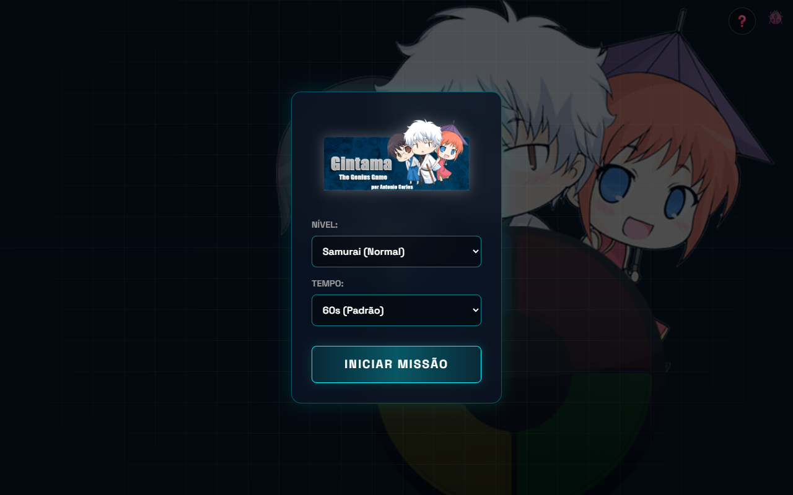
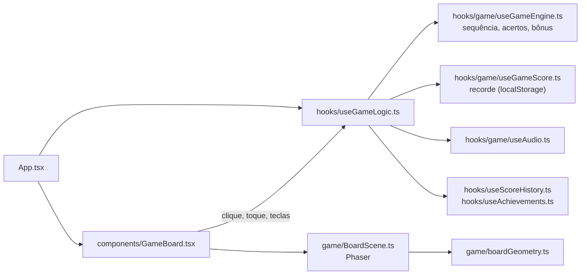

<div align="center">

# 🍓 Gintama Genius

**Um jogo de memória e reflexos inspirado no universo de Gintama.**<br/>
Repita sequências de cores em um tabuleiro neon renderizado com Phaser, com combo, modo Fever e conquistas.

[](https://github.com/juninmd/Gintama-Genius/actions/workflows/validate.yml)
[](https://github.com/juninmd/Gintama-Genius/actions/workflows/deploy.yml)

[](https://github.com/juninmd/Gintama-Genius/pkgs/container/gintama-genius)

<br/>



</div>

## 📝 Descrição

**Gintama Genius** é um web game que desafia sua memória com personagens e referências da série Gintama. Desenvolvedores com foco em animações fluidas e uma experiência de usuário divertida (e um pouco caótica, como a própria série).

<div align="center">



</div>

## 🎮 Como Jogar

1. Clique em **Iniciar Missão** e escolha dificuldade e tempo.
2. Observe a sequência de cores (verde, vermelho, azul, amarelo) e repita na mesma ordem.
3. Cada acerto aumenta pontos, combo (streak) e nível; 10+ acertos seguidos ativam o **modo Fever**.
4. Controles: mouse/toque no tabuleiro, teclas `1-4`, `R G B Y` ou setas; `Esc` pausa, `M` muda o som, `H` abre a ajuda de atalhos.

## ✨ Novidades

- **Phaser 4**: o tabuleiro é renderizado em um canvas Phaser (WebGL/Canvas) com fatias neon,
  brilho em camadas, partículas aditivas a cada nota e hub giratório com o kanji 銀.
- Tabuleiro flutuante com gradiente/glow e suporte a `prefers-reduced-motion`.
- Animações suaves via tweens (acender rápido, apagar gradual) e toque com hit-test geométrico.

## 🧭 Como Funciona



## 🛠️ Tech Stack

- **Frontend**: [React 19](https://react.dev/) + [Vite](https://vite.dev/) + [TypeScript](https://www.typescriptlang.org/)
- **Testes**: [Vitest](https://vitest.dev/) + [Testing Library](https://testing-library.com/)
- **Engine de jogo**: [Phaser 4](https://phaser.io/) (tabuleiro, partículas, tweens)
- **Animações de UI**: [Framer Motion](https://www.framer.com/motion/)
- **Efeitos**: [Canvas Confetti](https://www.npmjs.com/package/canvas-confetti)
- **CI/CD**: GitHub Actions + Docker + GHCR
- **Deployment**: Nginx + Docker (imagem publicada no GHCR); `netlify.toml` incluso para Netlify

## 🚀 Como Rodar Localmente

```bash
# Clone o repositório
git clone https://github.com/juninmd/Gintama-Genius.git

# Entre na pasta da web
cd Gintama-Genius/gintama-genius-web

# Instale as dependências
pnpm install

# Inicie o servidor de desenvolvimento
pnpm dev
```

## 🧪 Testes

```bash
# Executar testes (modo watch por padrão)
pnpm test

# Executar uma vez, sem watch
pnpm test run

# Executar testes com cobertura
npx vitest run --coverage

# Lint
pnpm lint
```

## 📦 Build

```bash
pnpm build
```

O build gera arquivos otimizados em `dist/` com:
- Minificação via Terser
- Source maps para debug
- Code splitting (vendor, motion, phaser, confetti chunks)
- Cache busting com hashes nos arquivos

## 🔍 Qualidade

- **Linting**: ESLint com TypeScript (`pnpm lint`)
- **Type Checking**: TypeScript strict mode (`pnpm build` roda `tsc -b`)
- **Test Coverage**: limiares configurados em `vite.config.ts` (80% statements, functions e lines; 75% branches)
- **Segurança**: Gitleaks em cada push (workflow `security.yml`)

## 🐳 Docker

```bash
# Construir imagem (a partir da raiz do repositório)
docker build -t gintama-genius .

# Executar container
docker run -p 80:80 gintama-genius
```

## 📦 Deployment

O deployment é automatizado via GitHub Actions:

| Workflow | Gatilho | Ação |
|----------|---------|------|
| `deploy.yml` | push em `main` ou `master` | Build da imagem Docker e push para o GHCR |
| `validate.yml` | PR e push em `main` ou `master` | Validação reutilizável de `juninmd/base-actions` |
| `security.yml` | push em `main` ou `master` | Gitleaks via `juninmd/base-actions` |
| `main.yml` | PR e push em `main` | Lint, testes, build e `semantic-release` |

## 📁 Estrutura do Projeto

```
gintama-genius-web/
├── src/
│   ├── components/    # Componentes React (HUD, menus, GameBoard)
│   ├── game/          # Cena Phaser (BoardScene) e geometria do tabuleiro
│   ├── hooks/         # Custom hooks
│   ├── utils/         # Utilitários
│   ├── styles/        # Arquivos CSS
│   └── assets/        # Recursos estáticos
├── public/            # Arquivos públicos
└── ...config files
Gintama Genius/        # Versão desktop original em VB.NET (Windows Forms)
```

## ⚠️ Limitações Conhecidas

> [!NOTE]
> A cobertura de testes atual (~47% de statements) está abaixo dos limiares configurados em `vite.config.ts`, então `npx vitest run --coverage` termina com erro de threshold. `src/game/BoardScene.ts` fica fora da cobertura.

- Os workflows `main.yml` e o fluxo descrito em [CONTRIBUTING.md](CONTRIBUTING.md) citam as branches `main`/`develop`, mas a branch padrão é `master`.
- O recorde, o histórico de pontuação e as conquistas ficam no `localStorage` do navegador; não há servidor.

## 🔐 Variáveis de Ambiente

O app não lê variáveis em runtime. Apenas o CI usa segredos:

| Variável | Descrição | Obrigatória |
|----------|-----------|-------------|
| `ENV_PRODUCTION` | Secret passado ao passo de build em `main.yml` | Não |
| `GITHUB_TOKEN` | Token do GitHub Actions (push no GHCR, semantic-release) | Automático |

## 🤝 Contribuindo

Veja [CONTRIBUTING.md](CONTRIBUTING.md) para guidelines de contribuição.

## 📄 Licença

MIT

---

> "ZURA JA NAI, KATSURA DA!"
